<picture>
  <source media="(prefers-color-scheme: dark)" srcset="docs/assets/header-dark.svg">
  
</picture>

<div align="center">

[](https://github.com/raven-clown/airlock/actions/workflows/ci.yml)
[](https://github.com/raven-clown/airlock/releases)
[](https://pkg.go.dev/github.com/raven-clown/airlock)
[](LICENSE)

</div>

One MCP endpoint in front of all your MCP servers, with real logins, per-person permissions, an audit log and rate limits.

> **Status: early, [v0.1.0](https://github.com/raven-clown/airlock/releases/tag/v0.1.0).** The gateway core works: one endpoint in front of stdio and Streamable HTTP servers, API key login, allow and deny rules, filtered tool lists, an audit log in SQL, and SQLite or Postgres. OIDC login, rate limits, the admin API and `airlock check` come next. Try it, but don't run it in production yet. Issues and pull requests are very welcome.

## How it works

<picture>
  <source media="(prefers-color-scheme: dark)" srcset="docs/assets/how-it-works-dark.svg">
  
</picture>

## Why

Once a team has more than a couple of MCP servers, the same questions come up. Who can call which tool? Who deleted that branch? Why does the intern's editor show a `drop_database` tool? Each MCP server answers these differently, or not at all.

airlock sits between MCP clients (editors, agents, scripts) and your MCP servers:

```
 editor / agent / script
          |  MCP over Streamable HTTP or stdio
      [airlock]  login, permissions, audit, rate limits
          |
  +-------+--------+-----------+
 github   files   logbook    any MCP server (stdio or HTTP)
```

- **One endpoint.** Clients connect once and see every tool, prefixed with the server name: `github__create_issue`, `files__read_file`.
- **Real identity.** Log in with any OIDC provider (Keycloak, Entra ID, Auth0, Dex, IdpForge) or use API keys for services. Groups come from your identity provider.
- **Permissions you can explain.** Allow and deny rules on users, groups and keys. Deny always wins and the default is deny. `airlock check` tells you which rule decided, without calling anything.
- **Filtered tool lists.** People only see the tools they may use. A hidden tool can't be called either.
- **Audit log.** Every call, allowed or not, is recorded with who, what, which rule and how long it took. Query it over the API.
- **Rate limits** per user, group, key and tool.
- **Runs anywhere.** One Go binary with embedded SQLite and no other dependencies. Use Postgres when you want several replicas. No Docker needed.
- **Built for a console.** Everything is managed through a JSON admin API (`/admin/v1/`, described in OpenAPI), so a new user can set it up without writing YAML. Teams that prefer GitOps can declare everything in a YAML file instead.

## Everything is free

There is no paid edition and no license key. SSO, roles and permissions, audit logs, multi-tenancy, clustering and the admin API are all in the Apache-2.0 build. Nothing is held back for an enterprise version.

## How it compares

| | docker/mcp-gateway | MCPJungle | agentgateway | airlock |
|---|---|---|---|---|
| Per-user login with OIDC groups | in the paid Enterprise Gateway | not mentioned | JWT, API keys, OAuth | yes, free |
| Allow and deny rules per tool | in the paid Enterprise Gateway | tool groups per client | CEL policies | yes, free |
| Explain a decision | not mentioned | not mentioned | not mentioned | `airlock check` |
| Audit log | in the paid Enterprise Gateway (SIEM) | "observability hooks" | OpenTelemetry | in SQL, queryable over the API |
| Rate limits | not mentioned | not mentioned | yes | yes |
| Needs Docker or Kubernetes | Docker | no | no, Kubernetes optional | no |
| Language | Go | Go | Rust | Go |

"Not mentioned" means the project's README doesn't describe it. The details and sources are in [docs/design.md](docs/design.md#how-airlock-compares). In short: docker/mcp-gateway is great for one person's desktop and sells per-user control separately, MCPJungle registers servers but describes only simple access control, and agentgateway does far more (A2A, LLM routing, Kubernetes) at the cost of much more to learn. airlock does one job and stays small enough to read in an afternoon.

## Install

With Go 1.26 or later:

```shell
go install github.com/raven-clown/airlock/cmd/airlock@latest
airlock version
```

Prebuilt binaries for Linux, macOS and Windows are planned.

## A taste

The YAML file below works today with `airlock serve --config airlock.yaml`. The admin API and `airlock check` are planned and don't work yet.

```shell
airlock serve
# prints a one-time admin key on first start

curl -H "Authorization: Bearer $KEY" localhost:8080/admin/v1/servers \
  -d '{"name":"github","transport":"stdio","command":"github-mcp-server","args":["stdio"]}'

curl -H "Authorization: Bearer $KEY" localhost:8080/admin/v1/rules \
  -d '{"name":"eng","subjects":["group:eng"],"allow":["github__*"],"deny":["github__delete_*"]}'

airlock check --user alice --group eng github__delete_repo
# DENY  github__delete_repo  rule=eng  reason="denied by pattern github__delete_*"
```

Or the same thing in a file:

```yaml
servers:
  - name: github
    transport: stdio
    command: github-mcp-server
    args: [stdio]
rules:
  - name: eng
    subjects: ["group:eng"]
    allow: ["github__*"]
    deny: ["github__delete_*"]
```

State lives in SQL, in `airlock.db` in the working directory by default. For teams and replicas, point every instance at one Postgres database:

```yaml
storage:
  driver: postgres
  dsn: postgres://airlock:secret@db:5432/airlock
```

Resources in the file are written to the database at startup and whenever the file changes, and every instance picks up a change within two seconds. `airlock migrate` applies database migrations without starting the server.

## Roadmap

**v0.1.0, released**
- stdio and Streamable HTTP backends, prefixed tool names, filtered tool lists
- API key login, allow and deny rules on users, groups and keys
- audit records for every call, in SQL and on stdout or a file, with retention
- `airlock serve` over HTTP or `--stdio`, `/healthz`, `/readyz`, config reload
- SQLite and Postgres with migrations, resources provisioned from the config file

**Next**
- OIDC login, `member` / `viewer` / `admin` roles
- `airlock check`, rate limits
- admin API with OpenAPI
- Prometheus metrics, OTLP traces

**After that**
- prompts and resources through the gateway
- token exchange (RFC 8693) for third-party HTTP backends
- sampling and elicitation passthrough
- per-user stdio processes
- organisations (multi-tenancy)
- the web console, in its own repository

## Part of a set

airlock is one of four projects that work alone and fit together, described in the [mothership contract](https://github.com/raven-clown/mothership/blob/main/CONTRACT.md):

- **airlock**: MCP gateway (this repository)
- **rosetta**: serve one agent over MCP, A2A, ACP and AG-UI
- **transponder**: one LLM API in front of Anthropic, OpenAI, Gemini and Ollama
- **logbook**: shared agent memory as an MCP server

## How to help

- Read [CONTRIBUTING.md](CONTRIBUTING.md) for setup, tests and how pull requests get merged.
- Pick an issue labeled [`good first issue`](https://github.com/raven-clown/airlock/labels/good%20first%20issue). Each one says which files to change and which tests to add.
- Bigger pieces are labeled [`adapter`](https://github.com/raven-clown/airlock/labels/adapter): a CEL or OPA policy, a Redis rate limiter, an OpenSearch or webhook audit sink. They sit behind small Go interfaces, so you can build one without touching the core.
- Found a bug, or want something new? Open an issue with one of the [issue forms](https://github.com/raven-clown/airlock/issues/new/choose). Each one says what to include.
- Pull requests come with a template that lists what reviewers check first in this project, so you know what to cover before you open one.
- Found a security problem? See [SECURITY.md](SECURITY.md).

## License

[Apache-2.0](LICENSE)
