<picture>
  <source media="(prefers-color-scheme: dark)" srcset="docs/assets/header-dark.svg">
  
</picture>

<div align="center">

[](https://github.com/raven-clown/airlock/actions/workflows/ci.yml)
[](https://github.com/raven-clown/airlock/releases)
[](https://pkg.go.dev/github.com/raven-clown/airlock)
[](LICENSE)
[](https://scorecard.dev/viewer/?uri=github.com/raven-clown/airlock)

</div>

One MCP endpoint in front of all your MCP servers, with real logins, per-person permissions, an audit log and rate limits.

> **Status: early, [v0.2.0](https://github.com/raven-clown/airlock/releases/tag/v0.2.0).** One endpoint in front of stdio and Streamable HTTP servers, OIDC and API key login, the `admin`, `viewer` and `member` roles, allow and deny rules, filtered tool lists, an audit log in SQL, the admin API with OpenAPI, limits from shared profiles, Prometheus metrics and OTLP traces, on SQLite or Postgres with several replicas. Try it, but don't run it in production yet. Issues and pull requests are very welcome.

## How it works

<picture>
  <source media="(prefers-color-scheme: dark)" srcset="docs/assets/how-it-works-dark.svg">
  
</picture>

## Why

Once a team has more than a couple of MCP servers, the same questions come up. Who can call which tool? Who deleted that branch? Why does the intern's editor show a `drop_database` tool? Each MCP server answers these differently, or not at all.

airlock sits between MCP clients (editors, agents, scripts) and your MCP servers:

```
 editor / agent / script
          |  MCP over Streamable HTTP or stdio
      [airlock]  login, permissions, audit, rate limits
          |
  +-------+--------+-----------+
 github   files   logbook    any MCP server (stdio or HTTP)
```

- **One endpoint.** Clients connect once and see every tool, prefixed with the server name: `github__create_issue`, `files__read_file`.
- **Real identity.** Log in with any OIDC provider (Keycloak, Entra ID, Auth0, Dex, IdpForge) or use API keys for services. Groups come from your identity provider.
- **Permissions you can explain.** Allow and deny rules on users, groups and keys. Deny always wins and the default is deny. `POST /admin/v1/check` tells you which rule decided, without calling anything.
- **Filtered tool lists.** People only see the tools they may use. A hidden tool can't be called either.
- **Audit log.** Every call, allowed or not, and every admin change is recorded with who, what, which rule and how long it took. Query it over the API.
- **Limits** from the profiles every mothership project shares: requests and tool calls per key, user or group, with the standard `RateLimit` headers.
- **Metrics and traces.** Prometheus on `/metrics` and OTLP traces, with a span for each request, tool call and backend call.
- **Runs anywhere.** One Go binary with embedded SQLite and no other dependencies. Use Postgres when you want several replicas. No Docker needed.
- **Built for a console.** Everything is managed through a JSON admin API (`/admin/v1/`, described in OpenAPI), so a new user can set it up without writing YAML. Teams that prefer GitOps can declare everything in a YAML file instead.

## Everything is free

There is no paid edition and no license key. SSO, roles and permissions, audit logs, multi-tenancy, clustering and the admin API are all in the Apache-2.0 build. Nothing is held back for an enterprise version.

## How it compares

| | docker/mcp-gateway | MCPJungle | agentgateway | airlock |
|---|---|---|---|---|
| Per-user login with OIDC groups | in the paid Enterprise Gateway | not mentioned | JWT, API keys, OAuth | yes, free |
| Allow and deny rules per tool | in the paid Enterprise Gateway | tool groups per client | CEL policies | yes, free |
| Explain a decision | not mentioned | not mentioned | not mentioned | `POST /admin/v1/check` |
| Audit log | in the paid Enterprise Gateway (SIEM) | "observability hooks" | OpenTelemetry | in SQL, queryable over the API |
| Rate limits | not mentioned | not mentioned | yes | yes |
| Needs Docker or Kubernetes | Docker | no | no, Kubernetes optional | no |
| Language | Go | Go | Rust | Go |

"Not mentioned" means the project's README doesn't describe it. The details and sources are in [docs/design.md](docs/design.md#how-airlock-compares). In short: docker/mcp-gateway is great for one person's desktop and sells per-user control separately, MCPJungle registers servers but describes only simple access control, and agentgateway does far more (A2A, LLM routing, Kubernetes) at the cost of much more to learn. airlock does one job and stays small enough to read in an afternoon.

## Install

With Go 1.26 or later:

```shell
go install github.com/raven-clown/airlock/cmd/airlock@latest
airlock version
```

Prebuilt binaries for Linux, macOS and Windows are planned.

## A taste

Start airlock with no config at all. On first start it prints an admin API key to stderr, once:

```shell
airlock serve
export KEY=alk_...   # the key it printed
```

Add a server, a rule and a key for a script, all over the admin API:

```shell
curl -H "Authorization: Bearer $KEY" localhost:8080/admin/v1/servers \
  -d '{"name":"github","transport":"stdio","command":"github-mcp-server","args":["stdio"],
       "env":{"GITHUB_PERSONAL_ACCESS_TOKEN":"${GITHUB_TOKEN}"}}'

curl -H "Authorization: Bearer $KEY" localhost:8080/admin/v1/rules \
  -d '{"name":"eng","subjects":["group:eng"],"allow":["github__*"],"deny":["github__delete_*"]}'

curl -H "Authorization: Bearer $KEY" localhost:8080/admin/v1/api-keys \
  -d '{"name":"ci","groups":["eng"]}'
# the answer holds the new key, once
```

Ask who may call what, without calling anything:

```shell
curl -H "Authorization: Bearer $KEY" localhost:8080/admin/v1/check \
  -d '{"user":"alice","groups":["eng"],"tools":["github__delete_repo"]}'
# {"items":[{"tool":"github__delete_repo","allow":false,"rule":"eng","reason":"denied by pattern github__delete_*"}]}
```

Secrets stay out of the database: server `env` values, and headers such as `Authorization`, are `${VAR}` references to airlock's environment, resolved when the server starts. The whole API is described in [api/openapi.yaml](api/openapi.yaml), which airlock also serves at `/admin/v1/openapi.yaml`.

Or the same thing in a file:

```yaml
servers:
  - name: github
    transport: stdio
    command: github-mcp-server
    args: [stdio]
rules:
  - name: eng
    subjects: ["group:eng"]
    allow: ["github__*"]
    deny: ["github__delete_*"]
```

`${NAME}` in a config value is read from the environment. It is an error when `NAME` is unset. `${NAME:-default}` uses `default` when `NAME` is unset or empty, so one file can be shared across environments. The default may be empty (`${NAME:-}`) and ends at the next `}`.

```yaml
listen_addr: "${AIRLOCK_LISTEN:-:8080}"
```

State lives in SQL, in `airlock.db` in the working directory by default. For teams and replicas, point every instance at one Postgres database:

```yaml
storage:
  driver: postgres
  dsn: postgres://airlock:secret@db:5432/airlock
```

Resources in the file are written to the database at startup and whenever the file changes, and are read-only through the API. Every instance picks up a change within two seconds, and the instance that took an admin write has it live before it answers. `airlock migrate` applies database migrations without starting the server.

## Sign-in and roles

Any OIDC provider works through plain discovery and JWKS. Tokens are checked locally against the provider's cached keys, so no call goes to the provider per request:

```yaml
settings:
  oidc:
    issuer: https://idp.example.com
    audience: airlock
    subject_claim: email          # default sub
    groups_claim: groups          # a dotted path such as realm_access.roles works too
role_bindings:
  - name: admins
    subjects: ["group:airlock-admins"]
    role: admin
```

MCP clients find the provider through `/.well-known/oauth-protected-resource`, which a 401 points at. Set `settings.public_url` to the address clients use, such as `https://airlock.example.com`: without it, that link is built from the request's `Host` header. API keys (`alk_...`) keep working beside OIDC.

The admin API has three roles, bound to the same subjects as rules: `member` reads its own identity, tools and audit records, `viewer` reads everything and may call `/check`, and `admin` changes things. An `admin` can add stdio servers, which run commands on the airlock host, so the role is as strong as a shell there. `stdio.allowed_commands` in the file narrows which programs the API may start, but not the arguments they get.

## Limits

Limits come from the profiles every mothership project reads. airlock enforces `requests` on every HTTP request and `tools.calls` on every tool call, and ignores the keys of the other projects, so one profiles list works for all four:

```yaml
profiles:
  - name: free
    limits:
      requests: {rate: 120/m, concurrency: 8}
      tools.calls: {rate: 30/m, concurrency: 2}
profile_bindings:
  - {name: ci, subject: "key:ci", profile: free}
settings:
  default_profile: free
limits:
  max_inflight: 1000     # per instance; past it, 503 overloaded
```

The most specific binding wins: key, user, group, the token's `tier` claim, then `default_profile`. `settings.org_profile` adds a limit every call must also pass. A request over `requests` gets 429 `rate_limited` or `concurrency_limited` with `Retry-After`, and every response carries `RateLimit-Policy` and `RateLimit`. A tool call over `tools.calls` gets a tool error the model can read, such as `rate_limited: tools.calls allows 30/m for user:alice; retry in 12s`, and the audit outcome `rate_limited`.

Each instance counts on its own for now, so with several replicas a caller can get up to the limit times the number of replicas. Shared counters are planned.

## Metrics and traces

`/metrics` serves Prometheus metrics with the names every mothership project shares: `airlock_requests_total`, `airlock_request_duration_seconds`, `airlock_inflight_requests`, `airlock_limited_total` and `airlock_events_dropped_total`, plus tool calls, backend state, auth failures and config reloads. No label carries a user, a key or tool arguments. `ops_listen_addr` moves `/metrics`, `/healthz` and `/readyz` to a port of their own.

```yaml
telemetry:
  otlp_endpoint: http://collector:4318   # OTLP over HTTP
  sample_ratio: 0.1
```

Each request, tool call and backend call gets a span, and backends receive a `traceparent` that continues the caller's trace.

## Roadmap

**v0.2.0, released**
- OIDC login with a cached JWKS and the protected resource metadata, `member` / `viewer` / `admin` roles
- the admin API with OpenAPI: servers, tools, rules, API keys, role bindings, settings, profiles, check and audit
- limits from shared profiles: `requests` and `tools.calls`, with `RateLimit` headers
- Prometheus metrics with the shared names, OTLP traces
- a bootstrap admin key on first start, `airlock bootstrap-key` and `airlock keys new`

**v0.1.0, released**
- stdio and Streamable HTTP backends, prefixed tool names, filtered tool lists
- API key login, allow and deny rules on users, groups and keys
- audit records for every call, in SQL and on stdout or a file, with retention
- `airlock serve` over HTTP or `--stdio`, `/healthz`, `/readyz`, config reload
- SQLite and Postgres with migrations, resources provisioned from the config file

**Next**
- limit counters shared across replicas
- usage events as CloudEvents, and the `gateway`, `admin` and `worker` roles
- encrypted secret values, personal API keys
- usage, sessions and export in the admin API, testing a server before saving it
- `airlock check` and `airlock tools` on the command line

**After that**
- prompts and resources through the gateway
- token exchange (RFC 8693) for third-party HTTP backends
- sampling and elicitation passthrough
- per-user stdio processes
- organisations (multi-tenancy)
- the web console, in its own repository

## Part of a set

airlock is one of four projects that work alone and fit together, described in the [mothership contract](https://github.com/raven-clown/mothership/blob/main/CONTRACT.md):

- **airlock**: MCP gateway (this repository)
- **rosetta**: serve one agent over MCP, A2A, ACP and AG-UI
- **transponder**: one LLM API in front of Anthropic, OpenAI, Gemini and Ollama
- **logbook**: shared agent memory as an MCP server

## How to help

- Read [CONTRIBUTING.md](CONTRIBUTING.md) for setup, tests and how pull requests get merged.
- Pick an issue labeled [`good first issue`](https://github.com/raven-clown/airlock/labels/good%20first%20issue). Each one says which files to change and which tests to add.
- Bigger pieces are labeled [`adapter`](https://github.com/raven-clown/airlock/labels/adapter): a CEL or OPA policy, a Redis rate limiter, an OpenSearch or webhook audit sink. They sit behind small Go interfaces, so you can build one without touching the core.
- Found a bug, or want something new? Open an issue with one of the [issue forms](https://github.com/raven-clown/airlock/issues/new/choose). Each one says what to include.
- Pull requests come with a template that lists what reviewers check first in this project, so you know what to cover before you open one.
- Found a security problem? See [SECURITY.md](SECURITY.md).

## Contributors

Thanks to everyone who has helped build airlock.

<a href="https://github.com/raven-clown/airlock/graphs/contributors"></a>

## License

[Apache-2.0](LICENSE)
